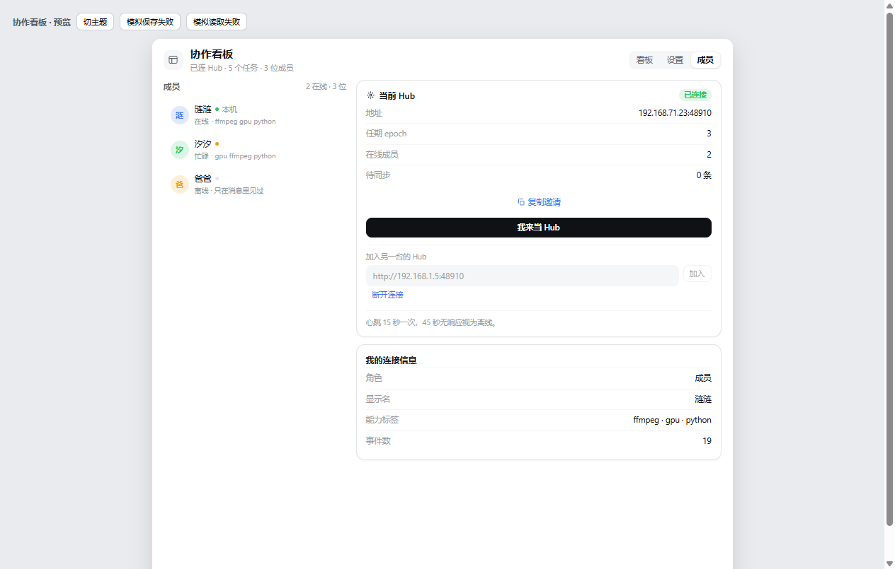
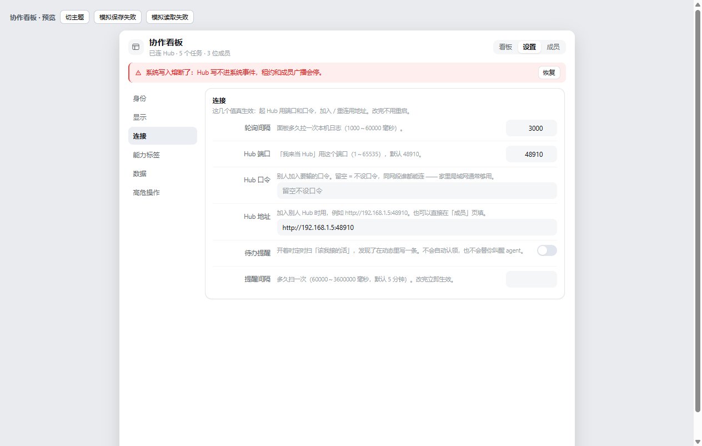
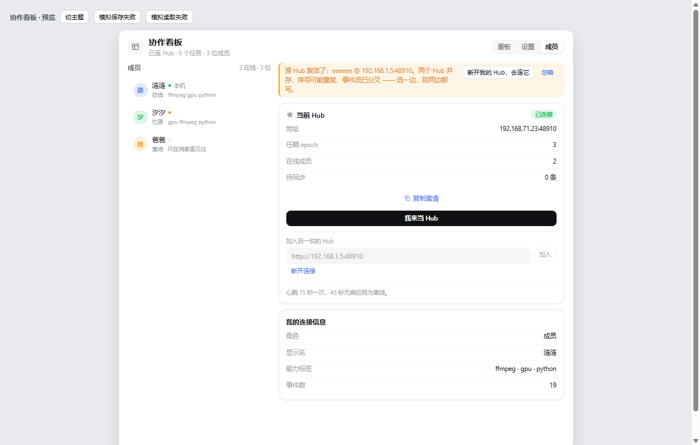

# dsh-collab-board · 协作看板

给 [DeepSeek Harness](https://github.com/deepseek-ai) 用的**局域网协作看板插件**：
多台机器之间共享任务卡、对话和产出文件，右侧边栏一屏看得见。

一台机器当 Hub，其它机器连上来。任务卡同步、串行认领、租约、文件传输、依赖自动解锁，
全部在一个插件里，不用额外跑服务。

> 这是一个完整的实现，不是设计稿。226 项自动化测试（含真实 HTTP 和真实 UDP 收发）全绿。

---

## 它解决什么问题

多个 AI 助手（或多人）在不同机器上干活时，最常见的三个坑：

1. **谁在干什么，看不见** —— 于是要么反复问，要么重复做
2. **同一件事两个人抢着做** —— 没有认领机制，谁也说不清归谁
3. **产出物要手动传** —— 截图、文档、安装包，靠聊天窗口来回拖

这个插件把这三件事收进一块共享的看板：任务卡有状态和归属，认领是原子的，
文件按内容寻址自动去重。

## 功能

| 模块 | 说明 |
|---|---|
| 任务卡 | 状态机 `待认领 → 进行中 → 已完成`，支持依赖、优先级、标签、截止时间 |
| 依赖闭环 | 创建时检测依赖环（有环直接拒）；前置完成后**自动**把依赖它的任务退回待认领 |
| 串行认领 | 两个人同时认领只有一个成功，另一个收到 `conflict`；租约到期自动释放 |
| 事件同步 | 所有机器共享一条有序事件流（`epoch` + `seq`），断线重连自动补齐 |
| 文件传输 | 按 sha256 内容寻址，同一份文件只存一次；下载落地到真实路径并校验 |
| 局域网发现 | Hub 每秒 UDP 广播；听到同组另一个 Hub 时告警（**不自动处理**，由人决定） |
| 系统写入熔断 | 系统事件写不进去时置熔断，不反复重试；界面红条 + 手动恢复 |

## 界面

成员与连接 —— 左边是成员，右边是当前 Hub 和加入入口：



设置 —— 五个分组，每个开关点完立刻生效：



两个 Hub 同时存在时的告警（**不自动处理**，由人决定谁是权威）：



## 安装

```bash
# 方式一：从 GitHub 拉下来装
git clone https://github.com/zxylqp/dsh-collab-board.git
cd dsh-collab-board
dsh plugin --profile desktop add "file:$(pwd)"

# 方式二：已经有本地副本
dsh plugin --profile desktop add "file:C:/path/to/dsh-collab-board"
```

装完**重启 DSH 桌面应用**：宿主半边只在启动时加载，客户端半边要页面重新加载才出现。
面板出现在右侧边栏，名字是「协作看板」。

## 两台机器怎么连

1. 甲机器打开「协作看板 → 成员」，点 **「我来当 Hub」**
2. 乙机器在同一个页面的输入框填 `http://<甲的局域网 IP>:48910`，点 **「加入」**
3. 口令在「设置 → 连接」里配；留空 = 同网段谁都能连。**口令存的是哈希，页面不回显**
   （显示「已设置 / 未设置」，输入新口令可在原处重设）

连上之后：甲建的任务卡，乙那边几秒内出现；任何一台点「认领」，另一台看到状态变「进行中」。

### 升级到 0.11.0（口令改为哈希存储）

两台机器都要升级并重启。顺序是 **先升 Hub、再升成员**：Hub 端明文和哈希都能校验，
成员端升级后只会发哈希，老 Hub 认不出来。升级后第一次启动会把 `settings.json` 里的
明文口令自动迁成 `v1$<sha256(groupId + 口令)>`，所以**必须重启 Hub 才生效**。

## 端口

| 端口 | 协议 | 用途 | 可配 |
|---|---|---|---|
| 48910 | TCP | Hub HTTP（加入 / 事件 / 认领 / 文件） | 是（设置里「Hub 端口」） |
| 48911 | UDP | Hub 每秒广播 + 双 Hub 告警 | 是（设置里「发现端口」） |

Windows 防火墙可能挡 UDP 48911。挡了不会崩，只是**发现不到别的 Hub**，手动填地址照常能用。
TCP 48910 必须放行，否则连不上。

## 给 AI 用的工具

插件注册了六个工具，agent 可以直接调：

| 工具 | 作用 |
|---|---|
| `collab_post` | 写一条记录：任务卡 / 进度 / 产出 / 系统提示 / 对话 |
| `collab_claim` | 认领任务（走 Hub 的串行通道，冲突会明确报错；可带 reason/plan） |
| `collab_hub` | Hub 控制：查看状态 / 起 / 停 / 加入 |
| `collab_attach` | 本地文件传到 Hub，同时写一条产物事件 |
| `collab_download` | 从 Hub 取文件，落到本地真实路径并校验 sha256 |
| `collab_state` | 读增量：归我的卡 / 待认领 / 新消息 / watching / others |

设计上有个约束值得说明：**产物先上传、再写事件**。反过来的话，对方拿到事件时文件还没到。

## 数据存在哪

```
~/.dsh/collab/
├── events.jsonl        本机事件日志（唯一事实源，只追加）
├── settings.json       设置
├── identity.json       设备身份 origin + 组身份 groupId
├── .synced.json        已同步事件 → Hub 分配的序号
├── hub.json            Hub 状态（epoch / headSeq / 幂等表）
├── hub-events.jsonl    Hub 侧的全组事件日志
├── hub-files/          Hub 收到的文件（按 sha256 前 32 位命名）
└── downloads/          下载落地的文件
```

数据目录可以在 `cordis.patch.yml` 里改（`dataDir`），改完要重启。

**全新安装是干净的**：仓库里只有代码，不带任何事件日志、身份文件或测试数据。
插件第一次启动时在 `~/.dsh/collab` 建一套空数据，生成新的 `origin` 和 `groupId`，
`role` 默认 `solo` —— 不会自动连任何 Hub，也看不到别人板上的历史。

想彻底重来（清空本机全部看板数据，从零开始）：先退出 DSH，再删掉数据目录。

```bash
rm -rf ~/.dsh/collab      # Windows: rmdir /s /q %USERPROFILE%\.dsh\collab
```

**升级不会清数据**：覆盖源码 + 重启即可，事件日志、身份、任务卡都保留。

## 开发

```bash
# 宿主集成测试：假 ctx 加载真的 apply()，不重启 DSH
node test/host.test.mjs       # 138 项

# Hub 端到端：起真服务、走真 HTTP、真实 UDP
node test/hub.test.mjs        # 88 项
```

注意 `node` 可能不在 PATH 上（DSH 自带的运行时在
`<DSH 安装目录>/resources/runtime/primary-runtime/dependencies/node/bin/`）。

**改完必须同步到 `node_modules`**：pnpm 的本地依赖是**复制**不是软链，
只改源码不重启是没用的，改了源码不复制也一样。

## 已知限制

- **默认不会自动叫醒 AI**：插件能写「有活等人接」的提示，也能自动认领任务卡，
  但 DSH 的 agent 只在被消息触发时跑一轮。打开 `wakeOnMessage` 后，收到别人的消息会调
  `sessionController.prompt` 叫起本机 agent —— **代价**是它会往对话里插一条真实消息。
  叫不醒不会静默丢：唤醒请求记在 `inflight.json`，失败按「唤醒重试」次数重试，
  重启后补投一次（0.10.9）。冷却期里来的消息也不再被丢掉，改成延后到冷却结束再投，
  同一张任务卡合并成一条、唤醒文本标「补叫」（0.10.10）。
- **依赖解锁会定向叫醒下游**（0.10.15）：A 的卡标 done，依赖它的 B 那张卡退回待认领，
  同时 Hub 以系统身份发一条 `msg` —— 收件人是「B 的 owner，没有就发给 B 的创建者」，
  对方开着 `wakeOnMessage` 就会被叫起来接。这条消息带 `to`，**只叫这一个人**：
  别的成员照收、照显示，但不为此烧一轮 token。
- **默认也不会自己接着转**：唤醒原本只有「别人发了消息」这一个来源，谁最后一条不回，
  链就断在那儿。打开 `wakeSelfContinue` 后，一轮唤醒投完、那张卡还是 running，插件会
  自己排下一次唤醒（等冷却结束再叫自己），任务标成 done 就停；同一张卡最多连续续跑
  `wakeSelfContinueMax` 次（默认 8），到了写一条 warn note 停下，不会无限刷。
  **默认关**：每转一轮都是一整轮 token。
- 成员在线态现在是真的：面板 5 秒问一次 Hub 的 `/members`（心跳 45 秒窗口）。
  单机 / 老宿主拉不到时退回事件流里的旧值
- 租约到期会退回待认领。长任务靠**写 progress 自动续约**（从认领起最多 4 倍），
  但一个闷头干活、一条进度都不写的 agent 照样会被释放 —— 那一刻看板上有一条
  warn note（「租约还剩 X 分钟」），不是静默的（0.10.13）
- 只做 hub 模式的文件传输，小文件内联进事件（inline）还没接
- **删除是墓碑，不是物理删行**（0.10.14）：事件流要跨机同步，删行会让对方以为没发生过。
  墓碑擦空正文、默认视图不显示，但日志里留一个 `taskId + deletedAt` 的壳。
  `retentionDays` 默认 30 天自动立碑；日志文件本身要变小，得等快照 / 归档那一轮
- 明确不做：审批流、事件回放、统计、搜索、任务转让、子任务、里程碑

## 发布

```bash
node publish.mjs            # 版本对齐 → 跑测试 → 同步安装位 → 推 GitHub
node publish.mjs --check    # 只检查并对齐版本号
node publish.mjs --dry      # 全做，但不推送
```

**版本号只有一个真源：`package.json`。** 客户端 `VERSION` 常量、CHANGELOG 顶部标题都由
脚本对齐 —— 以前这三处各写一遍，于是出过「磁盘 0.10.15、宿主 0.10.14、GitHub 0.10.12」
这种三张皮。

推送走 GitHub **Git Data API**（`api.github.com` 在 `no_proxy` 里，直连可用），不依赖本地
git 历史，也不依赖 `127.0.0.1:7897` 那个经常没开的代理。本地 `.git` 只当工作副本，
**别拿它判断发布状态** —— 版本以 `package.json` 和 GitHub 上的文件为准。

宿主进程要重启才加载新代码；`/collab-board/version` 报的是宿主**实际加载**的版本，
跟磁盘对不上就是还没重启。

## 许可

MIT
